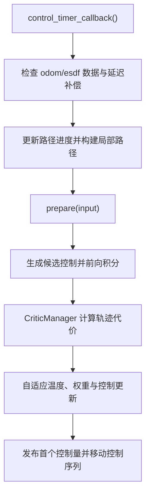

# Planning（规划与控制）模块设计

本文介绍 TrailBlazer Planning 模块中全局规划、路径优化和局部规划三个部分的设计思路、数据接口与主要参数。

| 子模块 | 当前实现 | 主要职责 |
| --- | --- | --- |
| `global_planner` | OccupancyGrid + ESDF 双引导 A* | 在全局地图上搜索安全、可行的离散路径 |
| `path_optimizer` | 均匀三次 B 样条 + L-BFGS | 将离散路径参数化并优化为连续平滑轨迹 |
| `local_planner` | 采样式 MPPI | 根据机器人状态、参考路径和 ESDF 实时生成控制指令 |

---

## 1. Global Planner

### 1.1 算法概览

当前全局规划器采用 OccupancyGrid 与 ESDF 双引导的八邻域 A*。主要**亮点**包括：

- OccupancyGrid 用于硬障碍判断和栅格软代价；
- ESDF 用于描述当前位置到最近障碍物的距离，并在安全距离内施加软代价；
- Octile 距离作为八邻域搜索的启发函数（用于计算 h 代价）；
- 对角移动时检查相邻正交栅格，避免路径穿过障碍物墙角；
- 当两个候选节点的 `f` 代价相同时，优先选择 `h` 更小、距离目标更近的节点（重载优先队列的运算符实现）。

### 1.2 A* 搜索流程

1. 将起点加入 open set；
2. 从优先队列中取出 `f = g + h` 最小的节点；
3. 若该节点已搜索过，则跳过；
4. 若到达目标点，则回溯父节点生成全局路径；
5. 否则遍历当前节点的八个邻居，计算新的累计代价；
6. 当新的 `g` 小于该邻居此前记录的 `g` 时，更新其代价（f）和父节点，并将新记录压入优先队列；
7. 重复上述过程，直到找到目标点或 open set 为空。

对于节点 `n`：

$$
f(n)=g(n)+h(n).
$$

邻居节点的累计代价可概括为：

$$
g(n')=g(n)
+c_{\mathrm{step}}
+w_{\mathrm{grid}}c_{\mathrm{grid}}(n')
+w_{\mathrm{esdf}}c_{\mathrm{esdf}}(n').
$$

Octile 启发距离为：

$$
h(n)=D(d_x+d_y)+(D_2-2D)\min(d_x,d_y),
$$

其中 `D` 为直移代价，`D_2` 为对角移动代价；常见取值为 $D=1$、$D_2=\sqrt{2}$。

### 1.3 优先队列中的重复节点与 `closed`

C++ 的 `std::priority_queue` 不支持直接降低某个已有元素的优先级。因此，当算法发现某个节点更小的 `g` 时，会将更新后的新记录再次压入队列，而旧记录仍留在队列中。这就是这里采用的“懒惰删除”策略。

后续弹出旧记录时，`closed` 数组可以识别该节点已经完成扩展并跳过它，避免重复搜索。相关实现可参见 `astar_esdf_global_planner.cpp` 中优先队列弹出与 `closed` 检查附近的源码注释。

### 1.4 输入与输出

| 类型 | 参数 | 说明 |
| --- | --- | --- |
| 输入 | `input_costmap_topic` | 栅格代价地图话题 |
| 输入 | `input_esdf_topic` | ESDF 地图话题 |
| 输入 | `input_odom_topic` | 机器人里程计话题 |
| 输入 | `input_goal_topic` | 目标点话题 |
| 输出 | `global_path_topic` | 全局路径发布话题 |

### 1.5 主要参数

| 参数 | 含义 |
| --- | --- |
| `if_keep_planning` | 是否针对同一目标持续重新规划；`true` 表示持续规划，`false` 表示每个目标只规划一次 |
| `min_dist_to_plan` | 触发规划所需的最小起终点距离 |
| `treat_unknown_as_obstacle` | 是否将未知栅格视为障碍物 |
| `obstacle_threshold` | 栅格代价大于等于该阈值时，将其视为不可通行障碍物 |
| `min_esdf_value_for_goal` | 目标点所需的最小 ESDF 安全距离；小于该阈值时拒绝规划 |
| `unknown_cost_penalty` | 不将未知栅格视为障碍物时，对未知栅格施加的代价 |
| `cost_scale` | OccupancyGrid 软代价权重 |
| `use_esdf_soft_cost` | 是否启用 ESDF 软代价 |
| `safe_clearance` | ESDF 安全距离；仅在距离障碍物小于该值时产生软代价 |
| `esdf_cost_scale` | ESDF 软代价权重 |
| `if_path_downsampling` | 是否对输出路径进行保拐点下采样；若后续使用 B 样条 + L-BFGS，通常不建议开启 |
| `corner_deg` | 判定路径拐点的角度阈值 |
| `corner_dilate` | 下采样时在拐点邻域额外保留的点数 |

---

## 2. Path Optimizer

### 2.1 算法概览

当前路径优化器首先将离散全局路径参数化为均匀三次 B 样条，再使用 L-BFGS 优化控制点。

不直接优化原始路径点，主要有以下原因：

1. **连续性更明确**

   三次 B 样条由分段三次多项式组成。在内部节点不重复的条件下，曲线内部天然具有 $C^2$ 连续性，即位置、一阶导数（速度）和二阶导数（加速度）连续。直接优化离散路径点，最终结果本质上仍是一条离散折线。

2. **局部支撑且影响连续**

   一个三次 B 样条控制点只影响相邻的有限曲线段，但会连续地改变这些曲线段（保证了局部支撑）。直接优化路径点时，障碍物梯度容易只推开单个离散点并形成尖刺；提高平滑权重又可能使整段路径过于僵硬。

3. **优化变量与输出采样解耦**

   L-BFGS 只需优化数量较少的控制点，最终轨迹仍可按照需要进行密集采样。

### 2.2 文件职责

| 文件 | 职责 |
| --- | --- |
| `lbfgs_bspline_optimizer.hpp` / `.cpp` | 路径优化算法接口层 |
| `lbfgs_backend.hpp` / `.cpp` | 代价、梯度及 L-BFGS 调用实现 |
| `uniform_bspline.hpp` / `.cpp` | 均匀三次 B 样条参数化与采样实现 |

### 2.3 输入与输出

| 类型 | 参数 | 说明 |
| --- | --- | --- |
| 输入 | `original_path_topic` | 原始全局路径话题 |
| 输入 | `input_esdf_topic` | ESDF 地图话题 |
| 输出 | `init_bspline_topic` | 初始 B 样条轨迹，仅用于调试和可视化 |
| 输出 | `optimized_path_topic` | 优化后的全局轨迹话题 |

### 2.4 均匀三次 B 样条

一条均匀三次 B 样条由多段三次多项式首尾连接而成。第 $i$ 段曲线由四个相邻控制点 $\mathbf{P}_i$、$\mathbf{P}_{i+1}$、$\mathbf{P}_{i+2}$ 和 $\mathbf{P}_{i+3}$ 决定：

$$
\mathbf{C}_i(s)
=B_0(s)\mathbf{P}_i
+B_1(s)\mathbf{P}_{i+1}
+B_2(s)\mathbf{P}_{i+2}
+B_3(s)\mathbf{P}_{i+3},
\qquad s\in[0,1].
$$

对应的均匀三次基函数为：

$$
\begin{aligned}
B_0(s)&=\frac{(1-s)^3}{6},\\
B_1(s)&=\frac{3s^3-6s^2+4}{6},\\
B_2(s)&=\frac{-3s^3+3s^2+3s+1}{6},\\
B_3(s)&=\frac{s^3}{6}.
\end{aligned}
$$

基函数可以通过 Cox–de Boor 递推公式推导，它们表示每个控制点对当前曲线点的权重。

有关 B 样条参数化部分，本实现是添加位置约束、起点/终点速度约束，通过最小二乘法求解得到控制点坐标，位置约束在每段的 $s=0$ 处建立，使输入路径点与样条分段连接位置保持一致。详细推导可参见 `uniform_bspline.cpp` 中该函数的源码注释。

### 2.5 L-BFGS 优化目标

L-BFGS 的求解入口位于 `lbfgs_backend.cpp` 的 `optimize()`（该函数的具体调用流程见源码注释）。当前总代价由四部分组成：

$$
J
=\lambda_{\mathrm{smooth}}J_{\mathrm{smooth}}
+\lambda_{\mathrm{distance}}J_{\mathrm{distance}}
+\lambda_{\mathrm{reference}}J_{\mathrm{reference}}
+\lambda_{\mathrm{curvature}}J_{\mathrm{curvature}}.
$$

| 代价项 | 作用 | 对应实现 |
| --- | --- | --- |
| 平滑代价 | 抑制控制点的高频变化，使轨迹更加平滑 | `computeSmoothnessCost()` |
| ESDF 距离代价 | 将轨迹推离距离过近的障碍物 | `computeDistanceCost()` |
| 参考路径代价 | 防止优化结果无约束地偏离原始全局路径 | `computeReferenceCost()` |
| 曲率代价 | 惩罚超过阈值的曲率 | `computeCurvatureCost()` |

实际的 L-BFGS 数值求解依赖第三方库 LBFGS-Lite；本模块自行实现的重点是上述代价与解析梯度（计算/代价公式推导可见对应函数注释）。

### 2.6 主要参数

#### 路径与代价参数

| 参数 | 含义 |
| --- | --- |
| `input_path_resolution` | 参数化前的输入路径分辨率 |
| `output_path_resolution` | 优化后输出路径的目标分辨率 |
| `output_parameter_step` | 沿样条参数 $s$ 采样时的步长，不等同于实际空间距离 |
| `if_reference_cost` | 是否启用参考路径代价 |
| `if_curvature_cost` | 是否启用曲率代价 |
| `lambda_smooth` | 平滑代价权重 |
| `lambda_distance` | ESDF 距离代价权重 |
| `obstacle_dist` | 产生 ESDF 距离代价的障碍物距离阈值 |
| `lambda_reference` | 参考路径代价权重 |
| `reference_tolerance` | 允许轨迹偏离参考路径的无惩罚范围 |
| `lambda_curvature` | 曲率代价权重 |
| `max_curvature` | 开始产生曲率代价的曲率阈值 |
| `tangent_epsilon` | 曲率计算中的退化保护正则项，通常无需调整 |
| `fixed_boundary_control_points` | 起点和终点侧固定的控制点数量；当前实现建议设置为 `3` |
| `optimization_samples_per_span` | 计算代价时，每段样条内的采样数量 |

#### L-BFGS 参数

| 参数 | 含义 |
| --- | --- |
| `if_lbfgs` | 是否启用 L-BFGS 优化 |
| `max_iterations` | 单轮优化允许的最大迭代次数 |
| `g_epsilon` | 梯度收敛阈值 |
| `memory_size` | 保存的历史 `(s, y)` 修正对数量，用于近似逆 Hessian 与计算搜索方向 |
| `lbfgs_past` | 判断目标函数相对改善量时使用的历史观察窗口 |
| `lbfgs_delta` | 基于历史目标函数相对改善量的停止阈值 |
| `max_linesearch` | 每次迭代在线搜索中允许尝试的最大步长次数 |

> [!NOTE]
> 除非出现收敛速度、内存占用或线搜索失败问题，通常不需要频繁调整 L-BFGS 内部参数。

---

## 3. Local Planner

### 3.1 算法概览

当前局部规划器采用采样式 MPPI。它以一条名义控制序列为中心生成带扰动的候选控制序列，通过运动学模型并行前向预测轨迹，利用多个 critic 为每条轨迹打分，再根据指数权重更新控制序列。

该过程以滚动时域方式重复执行：每个控制周期只输出优化序列的第一个控制量，剩余序列在启用 `shift_control_sequence` 时前移并作为下一轮 warm start。

该采样与代价加权思想与经典 MPPI 一致；本项目在此基础上加入了相关噪声、成对扰动、确定性候选序列、自适应 temperature、延迟补偿以及面向路径跟踪的组合 critic。

### 3.2 控制流程

具体调用顺序如下：

1. `control_timer_callback()` 检查 odometry、ESDF 等输入是否可用或超时；
2. `compensateStateLatency()` 根据观测延迟、当前速度和加速度约束，向前外推当前状态；
3. `PathManager::updateAndBuildLocalPath()` 更新内部 progress index、构建局部参考路径并判断是否到达终点；
4. 构造优化输入并调用 `evalControl()`；
5. `prepare(input)` 写入位姿、速度和 ESDF，并将局部路径转换为优化器内部张量；
6. 每次 `optimizeOnce()` 执行以下操作：
   - 将候选轨迹代价清零；
   - `noise_generator_.generate()` 生成控制噪声；
   - `noise_generator_.apply()` 将噪声叠加到名义控制序列；
   - 注入名义序列、原地旋转等确定性候选控制序列；
   - `integrateCandidateTrajectories()` 根据运动学模型预测全部候选轨迹；
   - `CriticManager::score()` 累加各个 critic 的轨迹代价；
   - `updateControlSequence()` 加入 MPPI 控制扰动代价，计算最优 temperature，分配权重并更新控制序列；
7. 从有效优化结果中取出第一个控制量作为当前周期的 `cmd_vel`；
8. 若启用控制序列平移，则将剩余控制量前移，作为下一控制周期的初始序列；若结果无效，则重置优化器。

### 3.3 轨迹权重与控制更新

设第 $k$ 条候选轨迹的总代价为 $J_k$，为提高数值稳定性，先减去最小代价：

$$
\rho=\min_k J_k.
$$

在 temperature 为 $\lambda$ 时：

$$
\tilde{w}_k
=\exp\left(-\frac{J_k-\rho}{\lambda}\right),
\qquad
w_k=\frac{\tilde{w}_k}{\sum_j \tilde{w}_j}.
$$

当前实现直接对候选控制序列进行加权：

$$
\mathbf{u}_t^{\mathrm{new}}
=\sum_{k=1}^{K}w_k\mathbf{u}_{k,t}.
$$

当所有候选都由“名义控制 + 扰动”构成时，上式等价于经典 MPPI 中“名义控制加权扰动”的更新形式。确定性候选序列则直接参与候选控制的加权。

### 3.4 Critic 组成

所有启用的 critic 都在同一轮 rollout 上计算并累加代价：

| Critic | 作用 |
| --- | --- |
| `ConstraintCritic` | 惩罚不满足速度或运动约束的候选；若采样与积分阶段已完成限幅，该项通常只承担补充约束和安全校验 |
| `EsdfFootprintCritic` | 查询机器人 footprint 采样点的 ESDF 距离；接近障碍物时施加平方排斥代价，发生碰撞时施加极大代价 |
| `PathFollowCritic` | 推动预测轨迹向前进展，使轨迹末端接近局部路径上的目标前瞻点（保证跟随路径向前走） |
| `PathTrackingCritic` | 联合约束横向位置、收敛航向、速度、横向收敛速度和角速度，使轨迹稳定跟随参考路径（保证走得稳） |

### 3.5 关键设计（亮点部分）

#### 3.5.1 状态延迟补偿

`compensateStateLatency()` 根据状态观测的时间戳、速度和加速度限制，将最近一次观测向当前时刻外推，以减小感知与控制链路延迟带来的相位滞后。

> [!NOTE]
> 延迟补偿得到的是基于运动模型的状态估计，而不是真实状态；补偿时间由 `max_state_extrapolation_sec` 限制。

#### 3.5.2 具有时间相关性的控制噪声

线速度和角速度噪声采用一阶 AR(1) 递推：

$$
\varepsilon_t
=\alpha\varepsilon_{t-1}
+\sqrt{1-\alpha^2}\,\eta_t,
\qquad \eta_t\sim\mathcal{N}(0,\sigma^2).
$$

若 $\varepsilon_{t-1}$ 与 $\eta_t$ 相互独立且方差均为 $\sigma^2$，则：

$$
\mathrm{Var}(\varepsilon_t)
=\alpha^2\sigma^2+(1-\alpha^2)\sigma^2
=\sigma^2.
$$

因此，在初始噪声也服从相同方差的条件下，该缩放可以在引入时间相关性的同时保持稳态方差不变。它**使相邻控制扰动更加平滑**，但候选控制是否真正可执行仍由速度、加速度约束和运动学积分共同决定。

相关性的半衰期为：

$$
t_{1/2}=\Delta t\frac{\ln(0.5)}{\ln(\alpha)}.
$$

当前 $\Delta t=0.1\,\mathrm{s}$ 时：

| 参数 | 相邻时间步相关性 | 相关性半衰期 | 0.5 s 后的相关性 |
| --- | ---: | ---: | ---: |
| `vx_alpha = 0.8` | $0.80$ | $0.31\,\mathrm{s}$ | $0.8^5=0.328$ |
| `wz_alpha = 0.9` | $0.90$ | $0.66\,\mathrm{s}$ | $0.9^5=0.590$ |

#### 3.5.3 成对扰动

噪声生成器将 batch 的后一半设置为前一半扰动的相反数，即同时加入 $\varepsilon$ 与 $-\varepsilon$。这种 antithetic sampling 可以减少有限样本造成的单侧随机偏置，**使本轮样本集合在正负方向上更加均衡**。

> [!NOTE]
> 成对扰动能够降低某一批样本整体偏左或偏右的概率，但不能单独保证控制系统不发生振荡。

#### 3.5.4 基于 ESS 的自适应 Temperature

归一化权重的有效样本数定义为：

$$
\mathrm{ESS}
=\frac{1}{\sum_{k=1}^{K}w_k^2}
=\frac{\left(\sum_k \tilde{w}_k\right)^2}
{\sum_k \tilde{w}_k^2}.
$$

自适应 temperature 根据当前轨迹代价分布选择 $\lambda$，使 $\mathrm{ESS}/K$ 尽量接近 `target_ess_ratio`：

- temperature 太低时，权重集中在极少数低代价轨迹上；
- temperature 太高时，权重趋于平均，优质轨迹的区分度下降；
- 自适应机制在两者之间寻找与目标 ESS 比率相匹配的权重分布。

> [!IMPORTANT]
> 该机制的目标是让有效样本比例接近设定值，而不是严格保证每轮有效样本数量完全不变；温度上下限、有限搜索精度和极端代价分布都会造成偏差。

#### 3.5.5 PathTrackingCritic

##### 统一 critic 的作用

将横向误差、航向误差等写在不同 critic 类中，并不会使它们“一会儿纠正航向、一会儿纠正横向位置”。`CriticManager` 会在同一条候选轨迹上累加所有启用 critic 的代价。

真正可能引发冲突的是各目标函数的参考量和生效条件彼此不协调。例如，机器人位于路径一侧但航向与路径平行时，单纯的路径切向航向代价会惩罚机器人为回到路径而暂时产生的收敛偏角。

本实现将这些量集中在同一个 critic 中，是为了共享同一套路径投影和曲率信息，并显式构造收敛航向、参考速度、横向速度和角速度门控，使各项代价共同描述同一个跟踪目标。

##### 1. 路径投影与基础误差

每个预测点不是简单匹配最近的离散路径点，而是在有限前向搜索窗口内投影到最近的路径线段。设投影点到预测点的位移为 $\mathbf{r}=(r_x,r_y)$，路径单位切向量为 $\mathbf{t}=(t_x,t_y)$，则带符号横向误差为：

$$
e_y=-r_x t_y+r_y t_x.
$$

按照当前约定，路径前进方向左侧为正。基础航向误差为：

$$
e_{\psi}=(\psi-\psi_{\mathrm{path}}).
$$

##### 2. 曲率前馈与参考速度（让机器人在拐弯处提前减速）

局部路径曲率通过前后若干线段的航向变化量与弧长之比估计：

$$
\kappa=\frac{\Delta\psi_{\mathrm{path}}}{\Delta s}.
$$

**曲率前馈速度**和**朝向角/横向误差反馈速度**分别为：

$$
v_{\mathrm{curve}}
=\frac{v_{\max}}{1+k_{\kappa}\lvert\kappa\rvert},
$$

$$
v_{\mathrm{error}}
=\frac{v_{\max}}
{1+k_y\lvert e_y\rvert+k_{\psi}\lvert e_{\psi}\rvert}.
$$

最终参考速度取二者中更保守的值，并限制在允许范围内：

$$
v_{\mathrm{ref}}
=\mathrm{clamp}
\left(
\min(v_{\mathrm{curve}},v_{\mathrm{error}}),
v_{\mathrm{curve,min}},
v_{\max}
\right).
$$

当前代价只惩罚超过参考速度的部分：

$$
e_v=\max(v_x-v_{\mathrm{ref}},0).
$$

因此，参考速度项主要用于弯道和较大跟踪误差下的超速抑制，不会为了追求参考速度而惩罚较慢的安全候选。

##### 3. 收敛航向与横向速度（惩罚不合理的朝向角）

根据带符号横向误差和当前线速度计算收敛角（公式推导见 path_tracking_critic.cpp 源码注释）：

$$
\theta_c
=\mathrm{clamp}
\left(
\mathrm{atan2}
\left(k_c e_y,\lvert v_x\rvert+v_{\mathrm{soft}}\right),
-\theta_{\max},
\theta_{\max}
\right).
$$

代码中的期望航向误差为：

$$
e_{\psi,\mathrm{desired}}=-\theta_c,
$$

因此**真正用于惩罚的组合航向误差**为：

$$
e_{\psi,\mathrm{tracking}}
=
\left(e_{\psi}-e_{\psi,\mathrm{desired}}\right).
$$

实际横向速度、期望横向速度及其误差为：

$$
\begin{aligned}
v_y&=v_x\sin(e_{\psi}),\\
v_{y,\mathrm{desired}}&=v_x\sin(e_{\psi,\mathrm{desired}}),\\
e_{v_y}&=v_y-v_{y,\mathrm{desired}}.
\end{aligned}
$$

##### 4. 参考角速度与门控（惩罚不合理的角速度）

**参考角速度**由路径曲率前馈和组合航向误差反馈组成：

$$
\omega_{\mathrm{ref}}
=v_x\kappa-k_{\omega}e_{\psi,\mathrm{tracking}},
\qquad
e_{\omega}=\omega-\omega_{\mathrm{ref}}.
$$

当机器人距离参考路径较远时，需要允许较强的转向动作以尽快收敛；接近路径后，才更强调角速度与参考角速度一致。因此，角速度误差项使用高斯形式的近路径**门控**：

$$
g(e_y)
=\exp
\left[
-\left(\frac{\lvert e_y\rvert}{d_{\mathrm{gate}}}\right)^2
\right].
$$

##### 5. 最终代价

单个预测时间步的跟踪代价为：

$$
\begin{aligned}
\ell_t={}&
w_y e_y^2
+w_{\psi}\left(1-\cos e_{\psi,\mathrm{tracking}}\right)
+w_v e_v^2\\
&+w_{v_y}e_{v_y}^2
+g(e_y)w_{\omega}e_{\omega}^2.
\end{aligned}
$$

这与代码中的五组权重一一对应：

| 数学符号 | 配置参数 |
| --- | --- |
| $w_y$ | `lateral_error_weight` |
| $w_{\psi}$ | `heading_error_weight` |
| $w_v$ | `speed_error_weight` |
| $w_{v_y}$ | `lateral_velocity_weight` |
| $w_{\omega}$ | `yaw_rate_error_weight` |

令 $\beta$ 表示配置参数 `time_discount`，则时间折扣为：

$$
q_t=\beta^t.
$$

最终不是简单地给总成本再乘一次 $0.98^t$，而是对每个预测时间步分别加权并归一化：

$$
J_{\mathrm{tracking}}
=w_{\mathrm{critic}}
\frac{\sum_t q_t\ell_t}{\sum_t q_t}.
$$

当 `time_discount = 0.98` 时，预测时域中越靠前的误差权重越大。

### 3.6 输入与输出

| 类型 | 参数 | 说明 |
| --- | --- | --- |
| 输入 | `input_esdf_topic` | ESDF 地图话题 |
| 输入 | `optimized_path_topic` | 优化后的全局路径话题 |
| 输入 | `goal_topic` | 目标点话题 |
| 输入 | `odom_topic` | 里程计话题 |
| 输出 | `mppi_predicted_path_topic` | MPPI 最优预测路径或调试路径话题 |
| 输出 | `cmd_vel_topic` | 机器人速度指令话题 |

### 3.7 主要参数

#### 控制与模型

| 参数 | 含义 |
| --- | --- |
| `control_period_sec` | 控制周期，单位为秒 |
| `compensate_state_latency` | 是否启用状态延迟补偿 |
| `max_state_extrapolation_sec` | 最大状态外推时间 |
| `vx_min` / `vx_max` / `wz_max` | 线速度和角速度约束 |
| `ax_min` / `ax_max` / `az_max` | 线加速度和角加速度约束 |
| `footprint_raw` | 机器人外轮廓顶点 |
| `footprint_sample_step` | footprint 边界的采样间隔 |

#### MPPI 优化器

| 参数 | 含义 |
| --- | --- |
| `optimizer_settings.adaptive_temperature` | 是否启用基于 ESS 的自适应 temperature |
| `optimizer_settings.target_ess_ratio` | 自适应 temperature 期望达到的有效样本比例 |
| `optimizer_settings.gamma` | MPPI 控制扰动代价系数 |
| `optimizer_settings.vx_std` | 线速度采样噪声的标准差 |
| `optimizer_settings.wz_std` | 角速度采样噪声的标准差 |
| `optimizer_settings.weight_logging_enabled` | 是否记录候选权重日志，需配合 `scripts/` 下的分析脚本 |
| `optimizer_settings.weight_log_file` | 权重日志输出文件路径 |

#### Critic 与路径管理

| 参数 | 含义 |
| --- | --- |
| `critics.path_follow.enable` | 是否启用 `PathFollowCritic` |
| `critics.path_follow.cost_weight` | `PathFollowCritic` 总权重 |
| `critics.esdf.enabled` | 是否启用 `EsdfFootprintCritic` |
| `critics.esdf.safe_distance` | 开始产生 ESDF 排斥代价的安全距离 |
| `critics.esdf.repulsion_weight` | ESDF 排斥代价权重 |
| `critics.path_tracking.enabled` | 是否启用 `PathTrackingCritic` |
| `path_manager.goal_tolerance` | 判断到达终点的距离阈值 |

其余 PathTracking 参数及调节方向可参见 `path_tracking_critic.cpp` 中的注释。

---

## 4. 规划互斥与 Lifecycle 协作

`global_planner` 和 `path_optimizer` 的算法核心使用 `planning_mutex_`，其主要作用是：

- 防止同一模块中的两轮规划或优化同时执行；
- 在生命周期节点 deactivate 时，等待当前计算安全退出后再继续资源停用；
- 避免算法运行期间相关地图、路径或发布资源被并发修改或销毁。

> [!NOTE]
> 普通 mutex 只能保证互斥进入临界区，并不保证多个等待回调严格按照到达时间 FIFO 执行。如果不希望高频请求在锁外排队，应该在调度层丢弃、合并或覆盖过期请求。

---

## 5. 参考资料

- Grady Williams, Andrew Aldrich, Evangelos Theodorou, [*Model Predictive Path Integral Control using Covariance Variable Importance Sampling*](https://arxiv.org/abs/1509.01149).